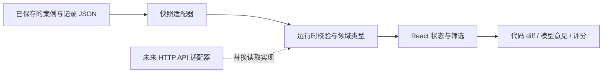

# Ainspector · 只读审查工作台

个人 UI 原型分支：`codex/review-ui-prototype`。这里把已有评测记录变成可阅读、可对照的中文界面。

## 启动

```bash
cd ~/Ainspector
git switch codex/review-ui-prototype
cd ui
node --version  # 推荐 Node.js 24；本目录 .nvmrc 已指定 24
npm ci
npm run dev
```

浏览器打开终端显示的 `http://127.0.0.1:5173/`。停止服务时，在该终端按 `Ctrl+C`。

如果你已经安装 nvm，但 Node 版本不是 24，在 `ui/` 中执行 `nvm install`、`nvm use`。没有 nvm 且当前已经是 Node 24，不需要额外安装它。

注意：命令应在 **ui/** 内运行。仓库根目录的 `npm run build` 构建的是原来的 Bot；这里的命令构建网页。前端有独立的 package.json、package-lock.json 和 node_modules，不使用 yarn，也不需要修改根目录锁文件。

```bash
npm test          # 数据关联、空响应、差异行号等边界测试
npm run build    # TypeScript 类型检查 + 生成 dist/
npm run preview  # 预览构建后的网页，通常是 http://127.0.0.1:4173/
```

这是本地开发/预览服务，默认只监听本机。`dist/` 是可部署的静态产物，但本阶段未部署公开网站。

## 建议这样体验

1. 默认的“删除管理员权限检查”：左侧看红色删除行，右侧看 DeepSeek 意见，再读下面的评分依据。区分模型的原话与评分者的判断。
2. 点击“新文件 L3 · 片段末行定位参考”：高亮表示评论挂载位置，不是模型精确指出的缺陷行。
3. 选择“数组循环多走一步”，切换 MiniMax：它命中了问题，但附带了一处解释错误。一次审查可以同时包含正确与错误的内容。
4. 点击“对照三个模型”，选择“需要其他文件才能判断”：观察模型是否擅自假定 timeout 的单位。
5. 选择“仅改变缩进”：DeepSeek 与 Gemini 没有提出问题，MiniMax 给出了风格意见。风格噪声和行为缺陷误报分开记录。
6. 打开“实验概览”，查看统计与评分口径；“导出当前快照”下载前端规范化后的 JSON，不含密钥。它不是完整原始 API 响应的备份。
7. “能力与扩展”说明后续模块与当前边界。窄屏通过右上角按钮展开案例导航；Escape 可关闭导航。

## 当前功能与数据含义

- 案例标题/文件名搜索、案例类别过滤、单模型阅读和三模型对照。
- unified diff（统一差异视图）：并列显示旧/新行号，红色删除、绿色新增。
- Markdown 评论展示、可验证的片段末行定位、模型无意见/缺少记录/加载失败状态。
- AI 辅助评分、误报依据、风格意见、解释错误和上下文边界。
- 实验统计、规范化 JSON 导出、响应式布局、键盘焦点。

**“修改风险评级：未评估”是明确状态，不是零分。** 这里没有安全评分算法。LGTM 只表示该次模型没有提出问题，不能证明修改安全；预设缺陷标签来自案例答案；已有评分由 Codex 辅助完成，不是独立人类盲评。

当前数据来自 `../docs/progress/2026-09-28/cases.json` 和 `records.json`：6 个虚构案例 × 3 个模型 × 每题 1 次，共 18 条真实调用记录。网页不会重新运行模型，刷新也不会消耗 API token。各模型的请求配置不完全相同，不能据此作普遍性能排名。

这是固定快照：修改原文件后，开发服务需要重新加载，生产构建需要重新执行 `npm run build`。新增实验推荐保存在新的日期目录，保留历史报告，并更新数据适配器的导入位置、日期与来源。当前快照约定“每个案例/模型只有一个样本”；重复样本会报错，避免界面悄悄选择错误记录。将来要比较重复实验，应先扩充实验选择器与样本 ID，而不是删除这个检查。

## 像公司分工一样理解代码

| 文件                            | 类比           | 专业职责                                      |
| ------------------------------- | -------------- | --------------------------------------------- |
| `src/main.tsx`                  | 接待入口       | 挂载 React 应用，加载字体与样式               |
| `src/App.tsx`                   | 工作台调度员   | 页面、筛选条件、模型选择、加载与错误状态      |
| `src/pages/`                    | 独立展示区     | 实验概览与后续能力说明页面                    |
| `src/data/snapshot.ts`          | 档案室         | 实现 ReviewRepository，异步加载并校验固定快照 |
| `src/domain/review.ts`          | 统一表格与合同 | 领域类型、Zod 运行时校验、读取接口、扩展契约  |
| `src/domain/diff.ts`            | 代码行号翻译员 | 把 patch 转成显示行，匹配可验证的评论位置     |
| `src/components/DiffView.tsx`   | 代码展示台     | 显示旧新行号、增加/删除行与定位高亮           |
| `src/components/ReviewCard.tsx` | 意见卡片       | 展示模型原文、评分及调用统计                  |
| `src/styles.css`                | 视觉规范       | 颜色、间距、排版、窄屏和键盘焦点              |
| `src/test/domain.test.ts`       | 边界检查员     | 验证纯删除、多片段、无效数据与未知用量        |

推荐阅读顺序：先 App 的筛选状态 → snapshot 数据来源 → review 数据类型 → ReviewCard → diff → DiffView → 测试。改字色和间距从 styles.css 开始；新增展示字段应先修改 review.ts 的 schema，再改对应组件。



**TypeScript** 检查开发时使用的字段；**Zod** 检查实际读到的数据。两者互补：后端返回了格式错误的 JSON，TypeScript 本身不会自动阻止它进入页面。

## 已保留的扩展点，以及还没有实现的部分

1. **动态数据**：`ReviewRepository.load(signal)` 是异步读取契约，组件不需要知道数据来自文件还是 HTTP。未来新增 HTTP 适配器，再增加实验列表、轮询或事件流即可。当前没有 API 服务、数据库或持久化交互状态。
2. **规则和模型证据**：`RiskAssessment` 区分未评估、证据不足和已评估。后者包含低/中/高风险、规则版本、base commit 和证据引用。它只是类型契约，尚无执行引擎。
3. **修改建议与补丁**：`PatchProposal` 预留 diff、基础提交、每个文件修改前后的哈希及状态。先实现补丁预览和校验，再实现文件写入。浏览器上的按钮不能单独保证操作安全。
4. **一键应用**：后端验证目标仍匹配 base commit / beforeHash，限制可写路径，执行检查，再由用户确认应用并记录操作 ID。并发请求应串行处理同一文件，失败时避免只写入一部分文件。
5. **撤回**：保存实际 before/after 内容或独立提交，检查当前文件仍匹配 afterHash；如果文件后来又被编辑，提示冲突并生成反向补丁供审阅，不能直接覆盖。

建议先以“风险等级 + 判断依据 + 未知项”表达，而不是立即给出 95% 这样的安全系数。真正的数字评分需要团队约定评分规则、权重、例外、版本，并用真实案例校准。UI 不应根据模型语气强弱推断概率。

动态调用还有一个现有代码约束：项目 Chat 从环境变量读取配置，当前评测脚本按顺序切换这些变量。未来 Web 后端不能靠“每个请求修改 process.env”来切换不同用户/模型，应先把模型、endpoint、密钥等改为显式实例配置，避免并发串用。密钥放在后端；任何 `VITE_*` 环境变量都应视为可能进入浏览器构建的公开配置。

当前 Markdown 不执行 HTML，也不加载模型回复里的图片或跳转链接。patch 解析器只用于显示统一差异片段，**不能拿它执行文件修改**。这两个限制要在接入真实 PR 内容时继续保持清楚。

## 验证与 Git 工作方式

UI 的构建和类型检查通过；9 项数据/差异边界测试通过。浏览器交互检查覆盖案例筛选、空结果、模型切换、三模型对照、定位高亮、概览与扩展页面，以及 390px 窄屏菜单和无整页横向溢出。浏览器检查属于交互验证，尚无持久化的端到端自动测试套件。

提交和同步时只选择 UI 文件与设计说明：

```bash
cd ~/Ainspector
git status --short
git add ui docs/plans/2026-09-28-review-ui-design.md
git commit -m "Improve review UI prototype"
git push origin codex/review-ui-prototype
```

`origin` 是个人 fork；`upstream` 是团队仓库。推送个人分支与向团队发 PR 是两步不同操作。不要使用 `git add .` 把本地依赖锁文件等无关改动一起提交。`ui/dist`、`ui/node_modules`、`.env` 均被忽略。
